**AI systems engineer.** I build agents that make real decisions (approve a payment, flag a scam,
route a crisis) and the checks that prove them right: rules where rules can decide, a model for the
gap, a deterministic checker behind it. Every number below comes from a test or eval in its repo.

[portfolio](https://pavanpatel.vercel.app) · [foundry](https://myselfpavan.vercel.app) · [linkedin](https://www.linkedin.com/in/pavan-patel-559195261/) · [x](https://x.com/pavan_pate78009) · [email](mailto:pavanpatela5598@gmail.com)

### Live, and measured

| | What it does | Measured |
|---|---|---|
| **[pramana](https://github.com/CODER7657/pramana)** · [live](https://pramana-gate.vercel.app) | Policy-as-code gate between AI shopping agents and checkout; no model on the money path | Attack success 53.8% → **0%** on 21 adversarial cases, 0/8 legitimate payments refused; found an enforcement gap in Google's AP2 SDK (AP2 #339 / #340) |
| **[raksha-ai](https://github.com/CODER7657/raksha-ai)** · [live](https://frontend-one-sage-77.vercel.app) | Scam detection by text or voice in English, Hindi and Gujarati: rules, then retrieval, then a grounded LLM | Recall **1.000**, precision 0.950 on 88 held-out cases; 1,092 backend tests |
| **[kisan_mitra](https://github.com/CODER7657/kisan_mitra)** · [live](https://kisan-mitra-gilt.vercel.app) | Voice crop advice for Gujarat's farmers, with a guard that removes every pesticide dose and brand | **0 doses, 0 brands** in 28 red-team attempts; 195 backend tests |
| **[voice-emotion](https://github.com/CODER7657/voice-emotion-detection)** · [live](https://vemo-api.vercel.app) | Speech emotion recognition that reports its real accuracy, in the browser | Found speaker leakage in my own eval; WavLM **0.75** macro-F1 on unseen speakers |
| **[AURA-GUARD](https://github.com/CODER7657/AURA-GUARD)** · [live](https://aura-guard-live.vercel.app) | Hourly NO₂ forecasts at US monitors from live EPA data, scored every hour | **33%** lower 12 h error than persistence over 2025; live MAE vs persistence on the site |

**Also:** [charkha](https://github.com/CODER7657/charkha) (agent-to-agent mesh from fire data to signed W3C credentials, 754 tests) ·
[complylite](https://github.com/CODER7657/complylite) (trade surveillance; LightGBM 0.97 PR-AUC vs 0.38 for rules, simulated market) ·
[genex-prj](https://github.com/CODER7657/genex-prj) (crisis routing: held-out recall 3/35 → 26/35, with a CI gate) ·
[22 Terminal-Bench 2 tasks](https://github.com/CODER7657/fix-broken-Terminal-Bench-2-Harbor-) for evaluating coding agents, each verifier checked three ways.

**Building:** trinetra and saakshi (investigation tooling; private until their evaluations are public).

**Recognition:** Maverick Effect AI Challenge 2026 finalist · HackerRank Orchestrate #205 of 4,094.

Python · TypeScript · SQL · FastAPI · PostgreSQL/pgvector · ONNX · LangGraph · MCP · A2A · LLM evals and red-teaming · GitHub Actions · Vercel 
B.Sc. Computer Science, BITS Pilani · B.E. Computer Science (Data Science), GTU · Ahmedabad, India
